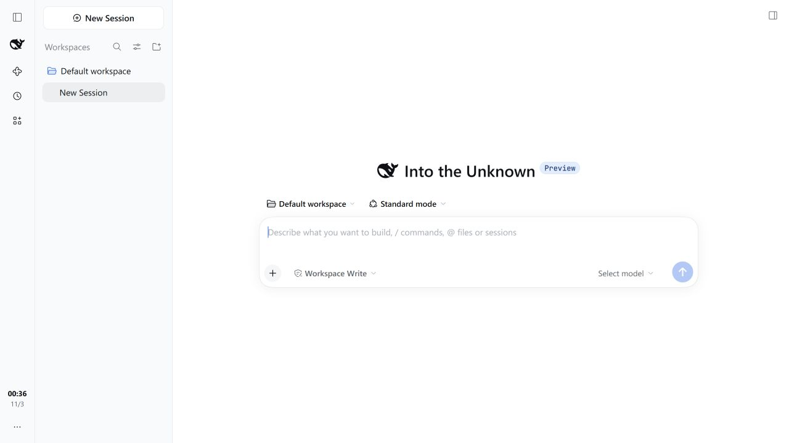
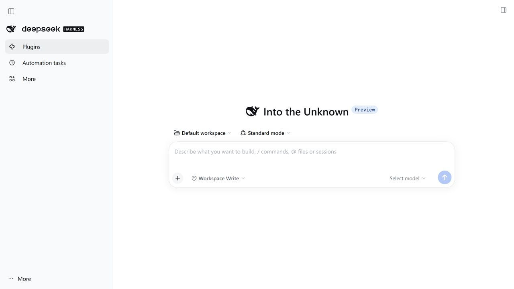

# Better Left Sidebar

[简体中文](README.md) | English

[](https://github.com/exoticknight/dsh-better-left-sidebar/actions/workflows/ci.yml) [](LICENSE)  [](https://github.com/exoticknight/red)

[](https://dsh.pub/en/plugins/?q=exoticknight%2Fdsh-better-left-sidebar) [](https://dsh.market/?q=exoticknight%2Fdsh-better-left-sidebar)

A clearer DeepSeek Harness sidebar with separate navigation and conversation regions and built-in widgets.

<!-- client:start -->

<div align="center">
  
  
</div>

<p align="center"><sub>Screenshots captured on DSH 0.2.1-rc.3.</sub></p>

<!-- client:end -->

## Features

> `0.2.0` adds a balance widget, preserves native overall collapse, and removes the old third-party widget slot. Plugins using that interface should read the upgrade notes below.

- **Keep conversations in the foreground**: workspaces and conversations stay in a dedicated wide pane; expanded navigation overlays it instead of squeezing the conversation area.
- **Tuck global entry points out of the way**: place the brand, panels, and tools along a narrow left rail to leave more room for browsing sessions.
- **Use navigation comfortably on desktop and touch**: desktop hover or keyboard focus expands by default; touch devices always get an explicit toggle that stays open after a tap and closes on an outside tap, item selection, Escape, or another tap.
- **Shape the sidebar around your workflow**: reposition the brand, global navigation, and tools, then review the layout preview before applying it.
- **Keep DSH's native actions**: overall collapse, New Session, panels, workspaces, settings, and footer tools keep their DSH entry points. Optionally use footer plugins' own compact views while navigation is closed.
- **Check time and balance**: built-in clock and balance widgets sit at the bottom of the rail. Enable, disable, or reorder them, customize the clock, and choose CNY or USD balance. Unavailable balances are hidden.

## Install

The current source was verified on DSH `0.2.1-rc.3` in the `web` profile. See the [compatibility record](docs/compatibility.md) for the supported range.

### Everyday users: npm release

Install the latest npm release:

```sh
dsh plugin --profile web add dsh-better-left-sidebar
```

Restart DSH after installing.

### Install from GitHub

You can also install the matching GitHub Release:

```sh
dsh plugin --profile web add github:exoticknight/dsh-better-left-sidebar#v0.2.1
```

Restart DSH after installing.

### Developers: local preview

Run these commands from the repository. Development uses the isolated `.dsh-cli/` and `.dsh-dev/` directories; it does not modify your everyday DSH profile.

```sh
pnpm install
```

```sh
pnpm dev:cli 0.2.1-rc.3
```

```sh
pnpm dev
```

## Usage

1. When enabled, workspaces and conversations have a dedicated region; the far-left rail holds the DSH brand, global panels, and tools. DSH's native button, desktop controls, and shortcuts still collapse and reopen the whole sidebar.
2. On desktop, hover over the rail or keyboard-focus a navigation item to reveal the full navigation. On touch devices, tap the navigation toggle; it stays open after release and closes when you tap outside, select an item, or press Escape. Click mode is also available in plugin settings.
3. Open **Plugins** in the sidebar, then **Better Left Sidebar** to configure expansion, animation, and region placement. Review the preview and select **Save settings** to apply changes. Copy follows DSH's active language; switch between Chinese and English in **Settings → General**.
4. Use **[Widgets](docs/compact-widgets.md)** on the same settings page to manage the clock and balance. The clock's **Display settings** control its hour cycle, date, weekday, and time color; Date and Weekday can both be checked. The balance's **Wallet currency** selects CNY or USD after saving. These are separate balances, not exchange-rate conversions. Widgets that do not fit are marked **Hidden: not enough space**.
5. To show other plugins' native status in the narrow rail, place **Tools and status** at **Navigation bottom**, enable **Show compact plugin status**, and save. Expanding navigation restores their full views; native overall collapse uses DSH's own layout.

### Upgrade from 0.1.x

`0.2.0` removes the `dsh-better-left-sidebar/slots` type entry and the `dsh-better-left-sidebar.footer.compact` public slot, retaining built-in widgets only. Third-party plugins using that interface must remove the integration or stay on `0.1.4` for now. Existing clock, layout, and navigation preferences remain usable; retired third-party ids no longer appear as unloaded widgets. Other plugins' footer content still renders through DSH's native slots.

## Configuration

After you select **Save settings**, layout preferences are stored in the current DSH profile's plugin configuration.

| Option | Default | Meaning |
| --- | --- | --- |
| Expansion | `hover` | Expand on desktop hover or keyboard focus; touch devices always show a navigation toggle. `click` pins the rail open with the toggle. |
| Animation | `standard` | Choose soft, fast, or no animation. |
| Brand | `navigation-top` | Place the brand at the top of the rail, at the top of the conversation pane, or hide it. |
| Global navigation | `rail` | Keep global navigation in the rail or move it above conversations. |
| Tools and status | `rail-bottom` | Keep tools at the bottom of the rail or move them below conversations. |
| Show compact plugin status | Off | At Navigation bottom, show each plugin's native compact view; expanding navigation restores its full view. |
| [Widgets](docs/compact-widgets.md) | Clock and balance enabled | Enable, disable, and reorder built-ins. They hide during overall sidebar collapse or navigation expansion. |
| Clock | 24-hour, month/day, primary color | 12-hour mode adds P or A after the time. Date and Weekday can both be checked. Choose Follow theme or Custom color; custom colors stay fixed across themes. The preview follows the draft, and the rail updates when you save. |
| Wallet currency | `CNY` | Select `USD` to show dollar balance; only one currency is shown. Query the account wallet first, then the configured official API key on failure or missing currency. Hide if neither is available; a real zero remains visible. |

## Update, roll back, remove

To update to or reinstall `0.2.1`, remove the plugin and install the exact version:

```sh
dsh plugin --profile web remove dsh-better-left-sidebar
```

```sh
dsh plugin --profile web add dsh-better-left-sidebar@0.2.1
```

To roll back, replace the version in the install command with `0.1.4`. [View GitHub Releases](https://github.com/exoticknight/dsh-better-left-sidebar/releases).

Removing the plugin uninstalls its package; conversations and other plugins in the DSH profile remain.

Developers can remove the plugin from the isolated preview profile:

```sh
pnpm dev:dsh --profile web plugin remove dsh-better-left-sidebar
```

## Privacy and data

DSH's configuration service stores the layout, widget order and enablement, clock style, and wallet currency you explicitly save.

While the balance widget is enabled and active and the page is visible, it queries immediately and refreshes about one minute after each query completes. Account-wallet queries use DSH's DeepSeek account service (default origin: `platform.deepseek.com`); the fallback runs on the Host against `https://api.deepseek.com/user/balance`. The Host resolves the configured API-key reference through DSH's credential service and sends the key only to the official HTTPS API, never to the browser or a third-party gateway; redirects are refused. Disabling the widget, collapsing the whole sidebar, expanding navigation, or hiding the page pauses subsequent refreshes.

The plugin reads no conversation content, writes no workspace files, keeps no separate credential store, and collects no telemetry. DSH owns account, credential, and configuration storage.

## Compatibility

Supports the `web` profile on DSH `>=0.2.0-rc.2 <0.2.2-0`. With Global navigation set to Above conversations, the global-navigation list scrolls independently to leave room for conversation content and footer tools; it shrinks first in short windows and can reach `0` at extreme heights. DSH's native “Standard mode” label can still truncate at a `567×626` viewport and the default `280px` or minimum `264px` sidebar width; widen the DSH sidebar if the full label matters. See the [compatibility record](docs/compatibility.md).

## Development

See [docs/development.md](docs/development.md), [CONTRIBUTING.md](CONTRIBUTING.md), and [AGENTS.md](AGENTS.md).

## License

[Apache License 2.0](LICENSE)
