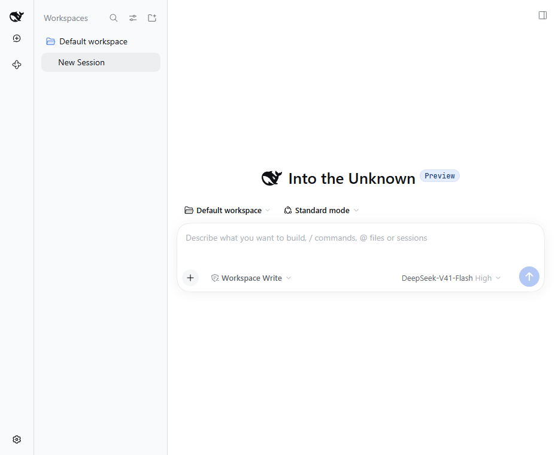
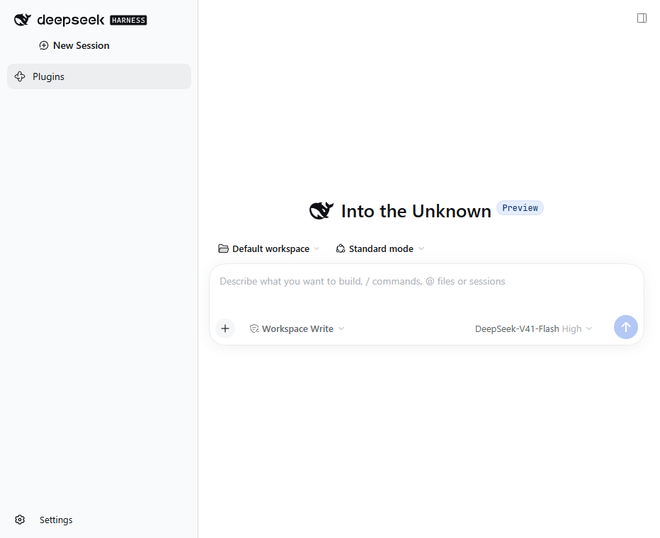

<!-- Writing guide: playbooks/reference/readme.md. Keep the same sections as README.md. -->

# Better Left Sidebar

[简体中文](README.md) | English

 [](https://github.com/exoticknight/red)

<!-- Listing badges: add a row here only after each listing is confirmed. See playbooks/reference/badges.md. -->

A conversation-first left navigation layout for DeepSeek Harness.

<!-- client:start -->

<div align="center">
  
  
</div>

<!-- client:end -->

## Features

- **Keep workspaces and sessions in view**: the session browser stays in its own wide column instead of competing with global navigation.
- **Open navigation on demand**: global panels start as icons; hover or keyboard focus opens a full overlay without shifting conversations.
- **Keep the conversation column open**: workspaces and sessions stay in the original wide panel, and the old collapse button is removed.
- **Keep controls consistent**: New Session, panel, and footer controls share a 36px default hit area.
- **Keep DSH's existing panels**: DSH-provided icons, labels, workspace list, settings, and footer actions remain in their existing slots.

## Install

Runtime verification passed on DSH `0.2.0-rc.2`, `0.2.1-rc.2`, and `0.2.1-rc.3` `web` profiles; see the compatibility record for the supported range. This checkout is not published to npm or GitHub Releases yet.

To preview it locally, run these commands from the repository:

```sh
pnpm install
```

```sh
pnpm dev:cli 0.2.1-rc.3
```

```sh
pnpm dev
```

This uses the DSH installation and profile isolated in the repository; it does not change your everyday DSH. Distribution install instructions will be added with the first release.

## Usage

1. The workspace and session column stays open. The far-left rail shows the DSH logo, New Session, global panels, and the footer entry.
2. Hover over the rail or keyboard-focus a navigation item to reveal the full labels in an overlay; leaving the rail closes it without moving the conversation column.
3. Open DSH settings from the footer entry. In DSH `0.2.1`, select “More / Account menu”, then “Settings”. The plugin has no separate settings page or sidebar-collapse button.

## Configuration

There are no plugin settings or saved values. Panel entries and labels come from the panels registered by the current DSH page.

## Update, roll back, remove

Only a local development version exists; there is no release to update or roll back to yet. During development, restart `pnpm dev` after rebuilding to load the updated code.

To remove it from the isolated development profile:

```sh
pnpm dev:dsh --profile web plugin remove dsh-better-left-sidebar
```

The plugin writes no settings, browser storage, or workspace files. Removing it leaves the conversations and other DSH data in `.dsh-dev/` intact.

## Privacy and data

The plugin rearranges DSH's existing sidebar, invokes DSH's native open action if the conversation column starts collapsed, and mirrors panel buttons' accessible names into native hover tooltips. It makes no network requests, writes no files, stores no credentials, and collects no telemetry. DSH continues to manage conversations and settings under its own storage rules.

## Compatibility

See [docs/compatibility.md](docs/compatibility.md).

## Development

See [docs/development.md](docs/development.md) and [CONTRIBUTING.md](CONTRIBUTING.md). When an AI agent develops, releases or maintains the plugin, have it read [AGENTS.md](AGENTS.md) first.

## License

[Apache License 2.0](LICENSE)
