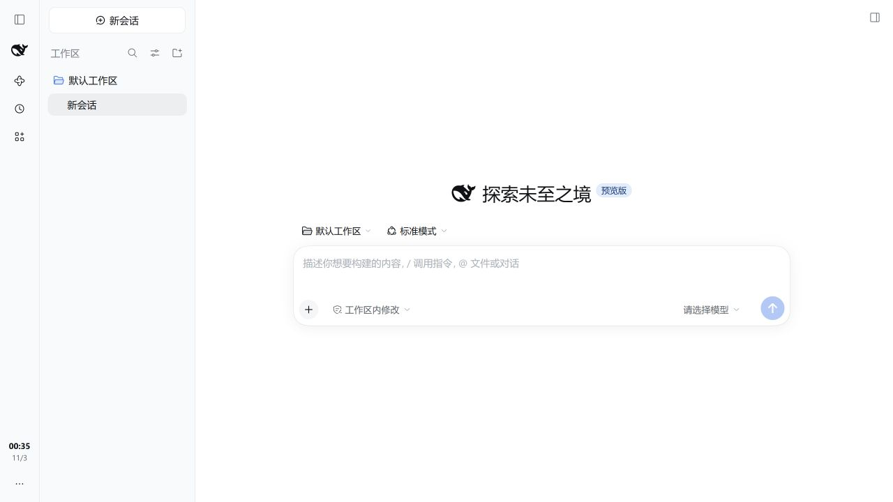
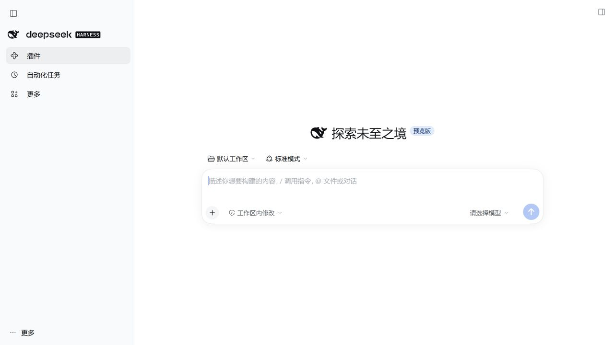

# 更顺手的左侧栏

简体中文 | [English](README.en.md)

[](https://github.com/exoticknight/dsh-better-left-sidebar/actions/workflows/ci.yml) [](LICENSE)  [](https://github.com/exoticknight/red)

[](https://dsh.pub/en/plugins/?q=exoticknight%2Fdsh-better-left-sidebar) [](https://dsh.market/?q=exoticknight%2Fdsh-better-left-sidebar)

分区更清晰的 DeepSeek Harness 左侧栏，内置时钟和余额小组件。

<!-- client:start -->

<div align="center">
  
  
</div>

<p align="center"><sub>界面截图基于 DSH 0.2.1-rc.3。</sub></p>

<!-- client:end -->

## 功能

> `0.2.0` 新增余额小组件，保留原生整体收起，并移除旧的第三方小组件插槽。依赖旧接口的插件请先阅读下方升级说明。

- **让会话始终留在主位**：工作区和会话列表保留在独立宽栏；展开导航时覆盖在其上，不会挤窄对话区。
- **把全局入口收纳起来**：品牌、面板和工具可分布在左侧窄栏，空出更完整的会话浏览区域。
- **桌面与触屏都好操作**：桌面默认悬停或键盘聚焦时展开；触屏设备始终显示导航按钮，轻触后保持展开，直到点击外部、选择导航项、按 Esc 或再次点击按钮。
- **按自己的习惯安排侧栏**：调整品牌、全局导航和工具区的位置；保存前可查看布局效果预览。
- **保留 DSH 原生操作**：整体收起、新建会话、面板、工作区、设置和页脚工具仍使用 DSH 的入口。可选择让页脚插件在导航收起时使用自身的紧凑样式。
- **随时查看时间与余额**：导航栏底部内置时钟和余额。可启用、停用、排序，调整时钟样式，并选择人民币或美元余额；余额不可用时自动隐藏。

## 安装

当前源码已在 DSH `0.2.1-rc.3` 的 `web` profile 验证；支持范围见[兼容性记录](docs/compatibility.md)。

### 普通用户：npm 发布版

安装 npm 上的最新发布版：

```sh
dsh plugin --profile web add dsh-better-left-sidebar
```

安装后重启 DSH。

### 从 GitHub 安装

也可以安装对应版本的 GitHub Release：

```sh
dsh plugin --profile web add github:exoticknight/dsh-better-left-sidebar#v0.2.1
```

安装后重启 DSH。

### 开发者：本地预览

在仓库目录运行以下命令。开发版使用独立的 `.dsh-cli/` 与 `.dsh-dev/`，不会改动日常使用的 DSH profile。

```sh
pnpm install
```

```sh
pnpm dev:cli 0.2.1-rc.3
```

```sh
pnpm dev
```

## 使用

1. 插件启用后，工作区与会话列表保留独立区域；最左侧窄栏放置 DSH 品牌、全局面板和工具入口。DSH 原生按钮、桌面控件和快捷键仍负责整个侧栏的收起与打开。
2. 桌面默认将鼠标移入导航栏或键盘聚焦导航项时展开；触屏设备轻触导航按钮即可展开，并在松手后保持，直到点击外部、选择导航项或按 Esc。插件设置也可切换为“点击展开”，由按钮固定或收起导航。
3. 打开侧栏的“插件”页，进入“更顺手的左侧栏”配置展开方式、动画和区域位置；修改布局后先看预览，再点“保存设置”。文案跟随 DSH 当前语言；在“设置 → 通用设置”切换简体中文或 English。
4. 在同一设置页的“[小组件](docs/compact-widgets.md)”管理时钟和余额。时钟的“显示设置”可改小时制、日期、星期和时间颜色，日期与星期可同时勾选。余额的“余额币种”可选人民币或美元，保存后生效；两种币种分别记账，不做汇率换算。空间不足时，组件行会显示“空间不足，暂未显示”。
5. 若要在窄导航栏显示其他插件的原生状态，将“工具与状态”放在“导航栏底部”，开启“收起导航时显示插件状态”并保存。导航展开时恢复各插件的完整样式；整个侧栏原生收起时，使用 DSH 自己的布局。

### 从 0.1.x 升级

`0.2.0` 移除了 `dsh-better-left-sidebar/slots` 类型入口与 `dsh-better-left-sidebar.footer.compact` 公共插槽，只保留内置小组件。依赖旧接口的第三方插件需要移除该集成，或暂时保留 `0.1.4`。已有时钟、布局和导航偏好继续使用；旧第三方组件 ID 不再显示为未加载项目。其他插件的页脚内容仍通过 DSH 原生插槽显示。

## 配置

布局偏好在点击“保存设置”后写入当前 DSH profile 的插件配置。

| 选项 | 默认值 | 说明 |
| --- | --- | --- |
| 展开方式 | `hover` | 桌面悬停或键盘聚焦时展开；触屏设备始终提供导航按钮。也可选 `click`，由按钮固定展开。 |
| 动画 | `standard` | 选择柔和、快速或关闭动画。 |
| 品牌区 | `navigation-top` | 可放在导航栏顶部、对话面板顶部，或隐藏。 |
| 全局导航 | `rail` | 可放在左侧导航栏，或移到对话列表上方。 |
| 工具与状态 | `rail-bottom` | 可放在导航栏底部，或移到对话列表下方。 |
| 收起导航时显示插件状态 | 关闭 | 工具位于导航栏底部时，显示各插件的原生紧凑样式；导航展开后恢复完整样式。 |
| [小组件](docs/compact-widgets.md) | 时钟与余额默认启用 | 在插件设置中启用、停用和排序；整个侧栏收起或导航展开时暂时隐藏。 |
| 时钟 | 24 小时，月/日，主色 | 小时制可选 12 小时，时间后加 P 或 A。日期和星期可以同时勾选。时间颜色可选“跟随主题”或“自定义颜色”，自定义颜色不随主题变化。预览跟随草稿，保存后收起栏才变。 |
| 余额币种 | `CNY`（人民币） | 可选 `USD`（美元），一次只显示一种。优先账号钱包，失败或缺少所选币种时尝试已配置的官方 API Key；两者均不可用时隐藏，真实零余额正常显示。 |

## 更新、回滚与卸载

更新到 `0.2.1` 或重新安装时，先移除插件，再安装精确版本：

```sh
dsh plugin --profile web remove dsh-better-left-sidebar
```

```sh
dsh plugin --profile web add dsh-better-left-sidebar@0.2.1
```

需要回滚时，将安装命令中的版本改为 `0.1.4`。[查看 GitHub Releases](https://github.com/exoticknight/dsh-better-left-sidebar/releases)。

移除插件只会卸载插件包；当前 DSH profile 中的会话和其他插件会保留。

开发者可从隔离的预览 profile 移除插件：

```sh
pnpm dev:dsh --profile web plugin remove dsh-better-left-sidebar
```

## 隐私与数据

插件通过 DSH 配置服务保存你明确提交的布局、小组件顺序与启用状态、时钟样式和余额币种。

余额组件启用且处于活动状态、页面可见时，会立即查询并在每次查询完成约一分钟后刷新。账号钱包查询使用 DSH 的 DeepSeek 账号服务（默认连接 `platform.deepseek.com`）；回退查询由服务端向 `https://api.deepseek.com/user/balance` 发起。API Key 从 DSH 凭据服务按已配置引用解析，仅用于官方 HTTPS 接口，不发送到浏览器或第三方网关，也不跟随重定向。停用组件、收起整个侧栏、展开导航或隐藏页面时暂停后续刷新。

插件不读取对话内容、不写入工作区文件、不单独保存凭据，也不采集遥测；账号登录信息、凭据和配置的存储由 DSH 管理。

## 兼容性

支持 DSH `>=0.2.0-rc.2 <0.2.2-0` 的 `web` profile。将“全局导航”设为“对话列表上方”时，导航列表独立滚动，为会话内容和底部工具留出空间；窗口变矮时导航区优先收缩，极端高度下可缩至 `0`。DSH 自带的“Standard mode”标签在 `567×626` 窗口和默认 `280px` 或最小 `264px` 侧栏宽度下仍可能被截断，可调宽 DSH 侧栏。详见[兼容性记录](docs/compatibility.md)。

## 开发

见 [docs/development.md](docs/development.md)、[CONTRIBUTING.md](CONTRIBUTING.md) 与 [AGENTS.md](AGENTS.md)。

## 许可证

[Apache License 2.0](LICENSE)
